# Presets

Each bundled preset showing `notifyd ctl preview` (critical, actions, volume bar, song with tags,
low). Taken under Xvfb without a compositor, so cards that are translucent on the desktop (deadd at
0.8, swaync at 0.8, dunst at 0.9, ...) are drawn over black here. `tools/gallery.sh` makes them again.

On your own display: `just preview` shows every preset side by side, one sample card each, until Enter
(`--urgency critical` to compare how each shows urgency, `just preview nord dracula` for some);
`just preview --each` steps through them with these five samples; `notifyd presets --pick` previews
them live on the daemon you run, from fzf.

The presets modeled on another daemon's theme name their source in a comment at the top of their file
(`src/notifyd/presets/NAME.yaml`); the values come from those files, and what the source does not set
(often low and critical colors, and the named classes) is filled in from the same palette.

## card

Rounded card for media - generous padding, soft border, large title.

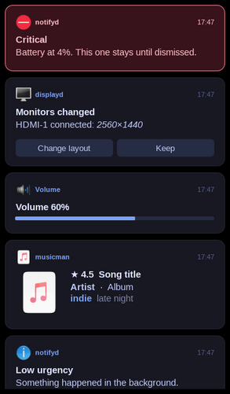

## catppuccin-latte

Catppuccin Latte - light off-white card, blue frame, orange frame when critical.

Source: catppuccin/dunst themes/latte.conf and catppuccin/mako (colors, critical frame #fe640b), catppuccin/swaync (geometry); all MIT. The low frame (surface1) is ours.

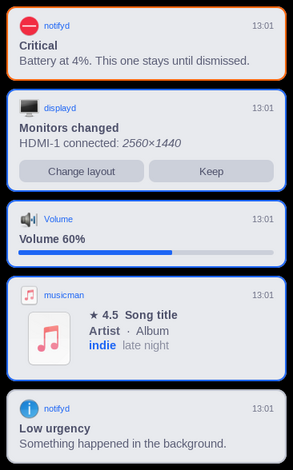

## catppuccin-mocha

Catppuccin Mocha - dark navy card, blue frame, peach frame when critical.

Source: catppuccin/dunst themes/mocha.conf and catppuccin/mako (colors, critical frame #fab387), catppuccin/swaync src/_theme.scss (12px radius, title/body/time colors); all MIT. The low frame (surface1) is ours.

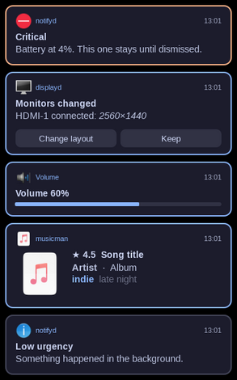

## deadd

Deadd-notification-center as configured here - black card at 0.8, no frame (picom draws the shadow), #acf text.

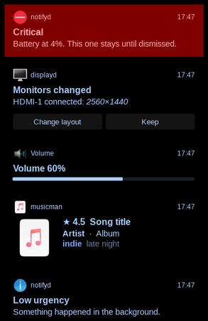

## dracula

Dracula - borderless dark card with a left stripe colored by urgency, red glow when critical.

Source: dracula/swaync style.css (MIT): #2b2d3b card, 11px radius, 4px purple stripe (low: comment #6272a4, critical: 5px red with a red ring), title #f8f8f2, body #a3a9c9, time #6272a4, critical title and time #ff6e6e, progress #bd93f9 on #21222c. The stripe is an inset box-shadow, as there.

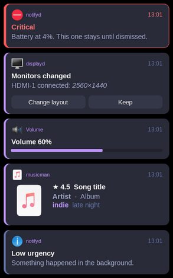

## dunst

The dunstrc in use here - Iosevka Term 13 on #000811, thin frame colored by urgency, rounded 5px.

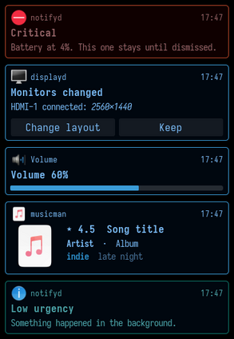

## gruvbox

Gruvbox dark - warm brown-gray card, thick cream frame, no frame when low, red when critical.

Source: wired-notify's default wired.ron (MIT): #282828, 3px #ebdbb2 border, rounding 3, low border #282828 (it disappears), critical #fb4934, bold #ebdbb2 summary. iruzo/gruvbox-swaync (MIT): time #83a598. Progress and class colors are from the Gruvbox palette.

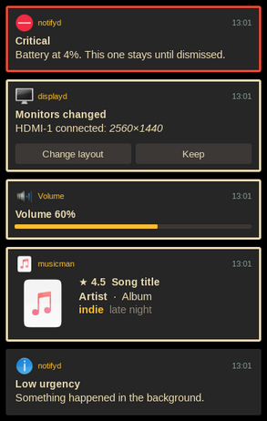

## high-contrast

Maximum legibility - opaque black, white text and frame.

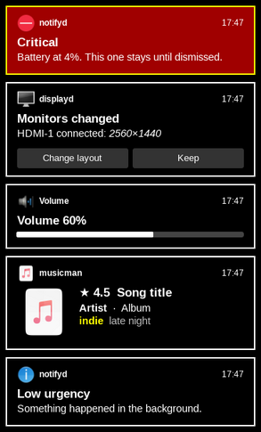

## kanagawa

Kanagawa - roomy ink-dark card, very rounded, blue frame, italic title.

Source: lokesh-krishna/dotfiles kanagawa/config/dunst/dunstrc (MIT): #1f1f28 on #dcd7ba, 2px #7e9cd8 frame, radius 15, padding 15/15, monospace 13, italic title (<i>%s</i>), 10px progress bar. Critical and low frames and the classes are from the Kanagawa palette.

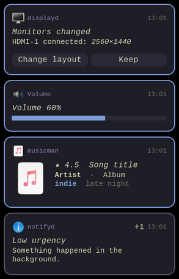

## minimal

Small and quiet - dark gray, no frame, compact text.

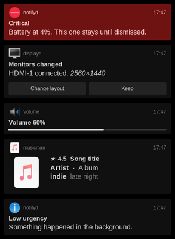

## nord

Nord - slate card, muted frame, a large frost-cyan title.

Source: zoddDev/Nord .config/dunst/dunstrc: #2E3440 on #D8DEE9 text, 2px #4C566A frame, radius 6, padding 8/13, title #88C0D0 x-large. Critical and low frames, progress and classes are from the Nord palette (aurora red #bf616a).

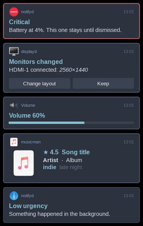

## one-dark

One Dark - square gray box, thick frame and text colored by urgency.

Source: NeuralNine/config-files old_configs/.config/dunst/dunstrc: #282c34, 3px frame, radius 0, padding 8/8, monospace; text low #98c379, normal #abb2bf, critical #e06c75; frame low #56b6c2, normal #61afef, critical #be5046. Progress and classes are from the One Dark palette.

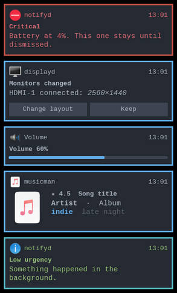

## rose-pine

Rosé Pine - background tinted by urgency, frame and title in pine, gold or love.

Source: d2718nis/rose-pine-dunst rose-pine.conf: per-urgency background and frame/title color (low #26273d/#31748f, normal #362e3c/#f6c177, critical #35263d/#eb6f92), frame 1, radius 2, padding 10. rose-pine/swaync (MIT): text #e0def4, body #908caa, progress #9ccfd8 on #1f1d2e, critical #eb6f92.

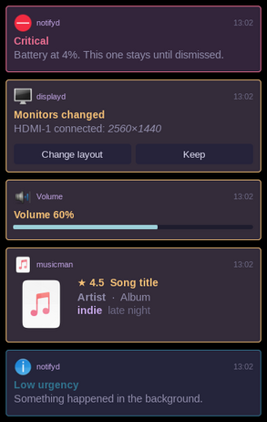

## solarized-light

Solarized light - parchment card, frame and text colored by urgency (blue, green, red).

Source: olsonbg/dotfiles config/dunst/dunstrc (GPL-3.0; colors and layout only): #fdf6e3 for every urgency, 3px frame, padding 10/10, frame and text low #268bd2, normal #859900, critical #dc322f. Progress and classes are from the Solarized palette.

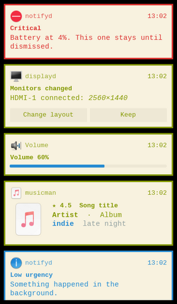

## swaync

SwayNotificationCenter's default - translucent gray card, hairline light border, large round corners.

Source: ErikReider/SwayNotificationCenter data/style/style.scss (GPL-3.0; values only): rgba(48, 48, 48, 0.8), white text, 1px rgba(255, 255, 255, 0.15) border, 12px radius, 16px bold summary and time, 15px body, buttons rgb(78, 78, 78). swaync draws no urgency difference; the red critical border is ours (GNOME's #e01b24). The soft shadow comes from the compositor.

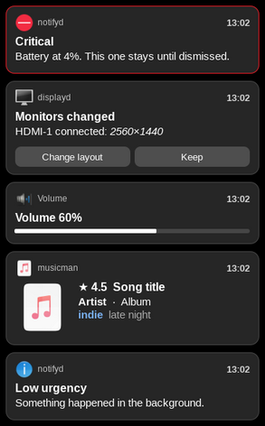

## tokyonight

Tokyo Night colors - framed in blue, urgency on the border.

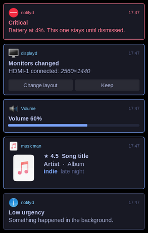

## xfce-retro

Xfce4-notifyd's Retro - sticky-note yellow, gray text, hairline frame.

Source: xfce4-notifyd themes/gtk-3.20/Retro/gtk.css (GPL-2.0; values only): #f9edbe, #555555 text, 1px border shade(bg, 0.8), radius 6, padding 20, bold summary, 6px progress shade(#555, 1.2). Retro has no urgency difference; the critical border and the classes are ours.

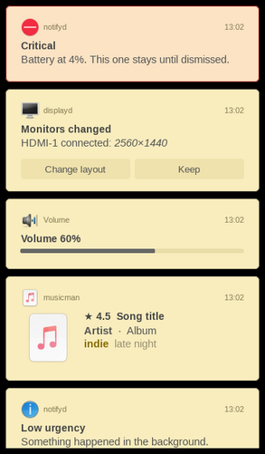
