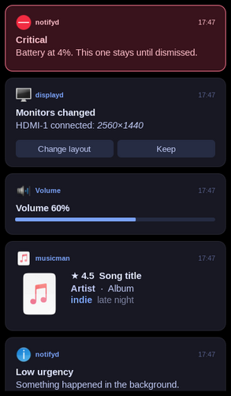
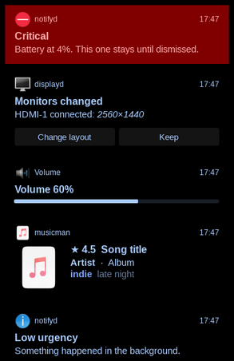
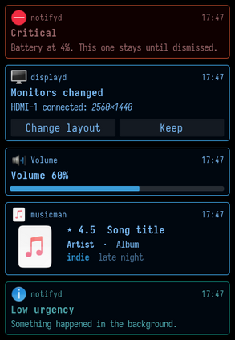
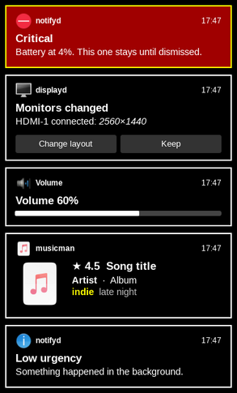
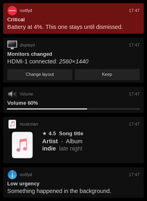
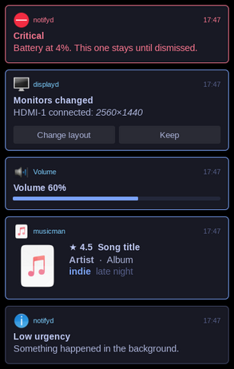

# Presets

Each bundled preset showing `notifyd ctl preview` (low, song with tags, volume bar, actions,
critical). Taken under Xvfb without a compositor, so cards that are translucent on the desktop
(deadd at 0.8, dunst at 0.9, ...) are drawn over black here. `tools/gallery.sh` makes them again;
`notifyd presets --pick` previews them live.

## card

Rounded card for media - generous padding, soft border, large title.

## deadd

Deadd-notification-center as configured here - black card at 0.8, no frame (picom draws the shadow),.

## dunst

The dunstrc in use here - Iosevka Term 13 on.

## high-contrast

Maximum legibility - opaque black, white text and frame.

## minimal

Small and quiet - dark gray, no frame, compact text.

## tokyonight

Tokyo Night colors - framed in blue, urgency on the border.

